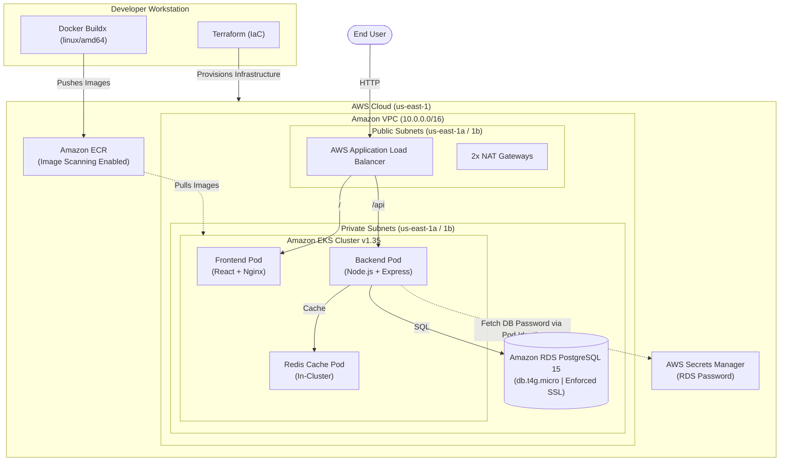

# Cloud-Native AWS EKS Platform

[](https://aws.amazon.com/)
[](https://kubernetes.io/)
[](https://www.terraform.io/)
[](https://aws.amazon.com/rds/)
[](https://www.docker.com/)

A production-style cloud platform built on **Amazon EKS** using **Terraform (IaC)**. Deploys a full-stack task management application (React + Node.js + Redis + PostgreSQL) across a highly available multi-AZ VPC, featuring path-based routing via the **AWS Load Balancer Controller** and credential-free authentication with **EKS Pod Identity** and **AWS Secrets Manager**.

---

## Architecture Diagram



---

## Key Features

- **Infrastructure as Code**: 100% reproducible AWS infrastructure provisioned with Terraform.
- **Network Isolation**: EKS worker nodes and RDS database isolated in private subnets with dual NAT Gateways.
- **Zero-Password Kubernetes**: Database master password generated by Terraform and stored in AWS Secrets Manager; backend pod retrieves credentials at runtime via **EKS Pod Identity**.
- **Native Ingress**: AWS Load Balancer Controller creates an internet-facing ALB routing `/` to the frontend and `/api` to the backend using IP target mode.
- **In-Cluster Caching**: Resilient Redis 7 deployment caching API queries with graceful fallback if unavailable.
- **Optimized Builds**: Multi-stage Docker builds targeting `linux/amd64` for binary compatibility with x86_64 nodes.

---

## Tech Stack

| Layer | Technologies |
| :--- | :--- |
| **Cloud Provider** | AWS (`us-east-1`): VPC, EKS, RDS, ECR, Secrets Manager, IAM |
| **IaC & Automation** | Terraform (AWS Provider `~> 6.0`) |
| **Container & Orchestration** | Kubernetes 1.35, Docker (`linux/amd64`), AWS Load Balancer Controller |
| **Application** | React + Vite (Frontend), Node.js + Express (Backend) |
| **Data & Cache** | PostgreSQL 15.19 (`db.t4g.micro`), Redis 7 Alpine |

---

## AWS Infrastructure Specifications

- **VPC (`10.0.0.0/16`)**: 2 public subnets (`10.0.1.0/24`, `10.0.2.0/24`) and 2 private subnets (`10.0.3.0/24`, `10.0.4.0/24`) across `us-east-1a` and `us-east-1b`.
- **Egress**: 1 Internet Gateway, 2 NAT Gateways (one per AZ) for high availability.
- **EKS Cluster (v1.35)**: Managed node group running `t3.small` instances (Desired: 2, Min: 1, Max: 3) strictly in private subnets.
- **RDS PostgreSQL 15**: Multi-AZ subnet placement, `db.t4g.micro`, `publicly_accessible = false`, custom parameter group enforcing SSL (`rds.force_ssl = 1`).
- **Amazon ECR**: Container image repository with vulnerability scan-on-push and lifecycle rules.
- **AWS Secrets Manager**: Encrypted password storage accessible strictly to the backend IAM role via EKS Pod Identity association.

---

## Security Practices

- **Private Subnets**: No public IP addresses on worker nodes or database instances.
- **Least-Privilege IAM**: Backend Pod Identity role only permits `secretsmanager:GetSecretValue` on the specific secret ARN.
- **No Hardcoded Secrets**: Zero credentials committed to Git or stored in Kubernetes Deployment manifests.
- **Vulnerability Scanning**: Automated image vulnerability scanning on push to ECR.
- **Least-Privilege Containers**: Backend runs under unprivileged `node` user; frontend runs minimal Nginx Alpine.
- **Network Boundaries**: RDS security group strictly restricts inbound traffic on port 5432 to the VPC CIDR.

---

## Repository Structure

```
cloudnative-eks-platform/
├── terraform/                       # Terraform infrastructure configurations
│   └── environments/dev/            # VPC, EKS, RDS, ECR, IAM, and Secrets Manager
├── application/
│   ├── frontend/                    # React SPA (Vite + Nginx multi-stage Dockerfile)
│   ├── backend/                     # Node.js REST API (Secrets Manager SDK integration)
│   └── docker-compose.yaml          # Local development stack
├── kubernetes/                      # Production Kubernetes manifests
│   ├── backend-deployment.yml       # Backend Pod (ServiceAccount: backend)
│   ├── backend-service.yaml         # ClusterIP service (:3000)
│   ├── frontend-deployment.yaml     # Frontend Pod (Nginx)
│   ├── frontend-service.yml         # ClusterIP service (:80)
│   ├── ingress.yaml                 # ALB Ingress (path routing / and /api)
│   └── redis.yaml                   # In-cluster Redis Deployment & Service
├── docker/                          # (Planned: Docker build automation)
├── helm/                            # (Planned: Helm chart packaging)
├── jenkins/                         # (Planned: Jenkins CI pipelines)
├── argocd/                          # (Planned: GitOps continuous delivery)
└── monitoring/                      # (Planned: Prometheus & Grafana stack)
```

---

## Deployment Summary

```bash
# 1. Provision Infrastructure
cd terraform/environments/dev
terraform init && terraform apply -auto-approve

# 2. Configure kubectl
aws eks update-kubeconfig --region us-east-1 --name cloudnative-eks-dev-platform-eks-cluster

# 3. Build & Push Multi-Arch Images
docker buildx build --platform linux/amd64 -t <ECR_URL>:backend-latest application/backend --push
docker buildx build --platform linux/amd64 -t <ECR_URL>:frontend-v2 application/frontend --push

# 4. Deploy Kubernetes Manifests
kubectl apply -f kubernetes/backend-serviceaccount.yaml
kubectl apply -f kubernetes/backend-secret.yaml
kubectl apply -f kubernetes/redis.yaml
kubectl apply -f kubernetes/backend-deployment.yml
kubectl apply -f kubernetes/backend-service.yaml
kubectl apply -f kubernetes/frontend-deployment.yaml
kubectl apply -f kubernetes/frontend-service.yml
kubectl apply -f kubernetes/ingress.yaml
```

---

## Real-World Challenges & What I Learned

- **RDS Free Tier Workaround**: Aurora Serverless encountered capacity limits in `us-east-1`; resolved by deploying standard RDS PostgreSQL 15 (`db.t4g.micro`) with custom SSL parameter groups.
- **Cross-Architecture Docker Builds**: Building images on Apple Silicon (ARM64) caused container crash loops on `t3.small` (x86_64) worker nodes; solved by cross-compiling with `docker buildx --platform linux/amd64`.
- **EKS Pod Identity Adoption**: Modernized workload authentication by configuring the `eks-pod-identity-agent` addon and associating IAM roles directly with Kubernetes ServiceAccounts, replacing legacy OIDC annotations.
- **ALB Path Routing Alignment**: Configured ALB Ingress paths to direct `/api` traffic to Express and `/` to React/Nginx with IP target mode for direct pod networking.

---

## Project Status & Roadmap

| Component | Status | Notes |
| :--- | :--- | :--- |
| **VPC & Networking** | Completed | Multi-AZ with private subnets and redundant NAT Gateways |
| **EKS & Node Group** | Completed | Kubernetes 1.35 on private `t3.small` nodes |
| **RDS PostgreSQL 15** | Completed | Enforced SSL, isolated in private DB subnet group |
| **Secrets Manager & Pod Identity** | Completed | Dynamic DB password retrieval without K8s secrets |
| **Application & Redis** | Completed | Deployed, cached, and tested through ALB ingress |
| **CI/CD & GitOps** | Planned | Jenkins pipeline and Argo CD GitOps integration |
| **Monitoring & HTTPS** | Planned | Prometheus/Grafana dashboards and ACM/Route 53 TLS |

> **Core Status**: Cloud infrastructure, containerization, and EKS deployments are **100% complete and verified**. CI/CD, GitOps, and monitoring directories exist as placeholders for planned future iterations.
