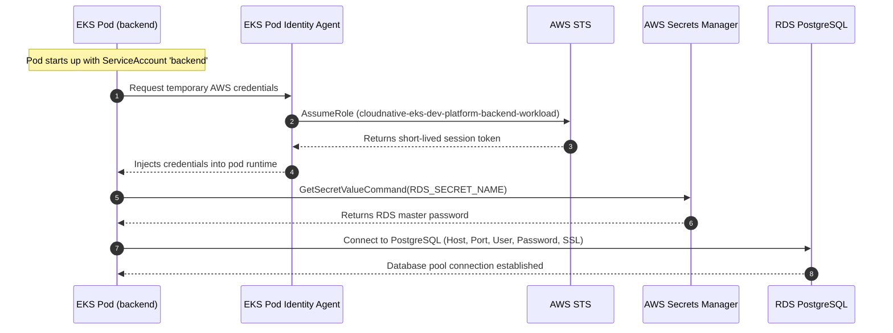

# Cloud-Native AWS EKS Platform

[](https://aws.amazon.com/)
[](https://kubernetes.io/)
[](https://www.terraform.io/)
[](https://aws.amazon.com/rds/)
[](https://www.docker.com/)
[](https://github.com/)

A production-style, containerized cloud infrastructure platform built on **Amazon Elastic Kubernetes Service (EKS)** using **Terraform (Infrastructure as Code)**. 

This repository provisions a secure, highly available AWS foundation (multi-AZ VPC, managed private EKS node group, private RDS PostgreSQL, and AWS Secrets Manager) and hosts a full-stack, distributed task management application with in-cluster Redis caching and an internet-facing Application Load Balancer configured via the **AWS Load Balancer Controller** and **EKS Pod Identity**.

---

## Table of Contents

- [1. Architecture Overview](#1-architecture-overview)
- [2. Architecture Diagram](#2-architecture-diagram)
- [3. Key Features](#3-key-features)
- [4. Technology Stack](#4-technology-stack)
- [5. AWS Infrastructure](#5-aws-infrastructure)
- [6. Application Architecture](#6-application-architecture)
- [7. Kubernetes Architecture](#7-kubernetes-architecture)
- [8. Security Practices](#8-security-practices)
- [9. Repository Structure](#9-repository-structure)
- [10. Deployment Overview](#10-deployment-overview)
- [11. Secrets Management Deep-Dive](#11-secrets-management-deep-dive)
- [12. Troubleshooting & Real-World Engineering Challenges](#12-troubleshooting--real-world-engineering-challenges)
- [13. What I Learned](#13-what-i-learned)
- [14. Future Improvements](#14-future-improvements)
- [15. Project Status](#15-project-status)

---

## 1. Architecture Overview

The platform is designed around cloud-native and defense-in-depth principles:

1. **Network Isolation**: The VPC is partitioned into two public subnets and two private subnets across two Availability Zones (`us-east-1a` and `us-east-1b`). All computational workloads (EKS worker nodes) and persistence layers (Amazon RDS) reside exclusively in private subnets with no public IPs.
2. **Ingress & Path Routing**: External HTTP traffic arrives at an internet-facing AWS Application Load Balancer (ALB) provisioned automatically by the AWS Load Balancer Controller. Path-based routing directs `/api/*` to the Express backend and all root paths (`/*`) to the React Nginx frontend.
3. **Pod Identity & IAM Least Privilege**: Pods authenticate to AWS services without static credentials. The AWS Load Balancer Controller and the backend workload use **EKS Pod Identity Associations** to obtain temporary IAM role credentials via the `eks-pod-identity-agent`.
4. **Dynamic Secret Retrieval**: The backend workload fetches its database password directly from **AWS Secrets Manager** at startup using the AWS SDK, preventing sensitive credentials from being stored in Kubernetes Deployment manifests or Git.
5. **State & Caching Layer**: Persistent data is stored in a private Amazon RDS PostgreSQL 15 instance with SSL enforced. Transient caching is handled in-cluster by a Redis 7 deployment with Append-Only File (AOF) persistence enabled.

---

## 2. Architecture Diagram

```mermaid
flowchart TB
    subgraph Developer_Environment["Developer / CI Workstation"]
        Dev["Developer"]
        TF["Terraform CLI\n(IaC Engine)"]
        DockerCLI["Docker Buildx\n(linux/amd64)"]
    end

    subgraph AWS_Cloud["AWS Cloud (us-east-1)"]
        ECR["Amazon ECR\n(Repo: cloudnative-eks-dev-platform-ecr-repo)\n• Image Scan on Push\n• Lifecycle Policy"]
        SM["AWS Secrets Manager\n(RDS Master Password)"]

        subgraph VPC["Amazon VPC (10.0.0.0/16)"]
            IGW["Internet Gateway"]

            subgraph Public_Subnets["Public Subnets (us-east-1a & us-east-1b)"]
                NAT1["NAT Gateway 1\n(10.0.1.0/24)"]
                NAT2["NAT Gateway 2\n(10.0.2.0/24)"]
                ALB["AWS Application Load Balancer\n(Internet-Facing)"]
            end

            subgraph Private_Subnets["Private Subnets (us-east-1a & us-east-1b)"]
                subgraph EKS_Cluster["Amazon EKS Cluster v1.35"]
                    LBC["AWS Load Balancer Controller\n(Pod Identity: kube-system)"]
                    
                    subgraph K8s_Workloads["Kubernetes Namespaces"]
                        Ingress["K8s Ingress\n(alb.ingress.kubernetes.io)"]
                        
                        subgraph Frontend_Pod_Group["Frontend"]
                            FrontSvc["frontend-service\n(ClusterIP: 80)"]
                            FrontPod["React + Vite Pod\n(Nginx 1.27 Alpine)"]
                        end

                        subgraph Backend_Pod_Group["Backend"]
                            BackSvc["backend-service\n(ClusterIP: 3000)"]
                            BackPod["Node.js + Express Pod\n(SA: backend / Pod Identity)"]
                        end

                        subgraph Redis_Pod_Group["In-Cluster Cache"]
                            RedisSvc["redis-service\n(ClusterIP: 6379)"]
                            RedisPod["Redis 7 Alpine Pod\n(appendonly: yes)"]
                        end
                    end
                end

                subgraph RDS_Subnet_Group["DB Subnet Group (Private)"]
                    RDS[("Amazon RDS PostgreSQL 15.19\n• db.t4g.micro\n• rds.force_ssl = 1\n• SG: Port 5432 (VPC only)")]
                end
            end
        end
    end

    User(["End User / Browser"])

    %% User Flow
    User -->|HTTP Requests| ALB
    ALB -->|Path: /api*| BackSvc
    ALB -->|Path: /*| FrontSvc
    FrontSvc --> FrontPod
    BackSvc --> BackPod

    %% Backend dependencies
    BackPod -->|SQL Queries (SSL Enforced)| RDS
    BackPod -->|Cache GET / SET| RedisSvc
    RedisSvc --> RedisPod
    BackPod -.->|Fetch RDS Password via Pod Identity| SM

    %% Ingress controller
    LBC -.->|Configures ALB Target Groups| Ingress
    Ingress -.-> ALB

    %% Provisioning & Delivery flows
    Dev -->|terraform apply| TF
    TF -->|Provisions VPC, EKS, RDS, ECR, IAM, Secrets| AWS_Cloud
    Dev -->|docker buildx push| DockerCLI
    DockerCLI -->|linux/amd64 Images| ECR
    ECR -.->|Pull images| EKS_Cluster
```

---

## 3. Key Features

- **Automated IaC Infrastructure**: Modular Terraform configuration provisioning VPC, subnets, routing tables, NAT gateways, EKS cluster, managed node groups, ECR, RDS, IAM roles, and Secrets Manager.
- **Modern EKS v1.35 Stack**: Deployed on Kubernetes 1.35 with managed node groups scaling between 1 and 3 `t3.small` worker instances.
- **Native AWS Ingress Integration**: Utilizes the AWS Load Balancer Controller with IP target mode for low-latency pod routing without NodePort overhead.
- **EKS Pod Identity (Modern IAM Authentication)**: Replaces traditional OIDC IRSA annotations with the lightweight `eks-pod-identity-agent` for the Load Balancer Controller and application workloads.
- **Secure Secrets Lifecycle**: Master database credentials generated randomly with Terraform, stored in AWS Secrets Manager, and queried directly by application code using AWS SDK v3.
- **Multi-Stage Container Builds**: Frontend compiled from Node.js build stage into an ultra-lean Nginx Alpine image; backend runs as a non-root `node` user.
- **Dual-Layer Health Checking**: Application exposes `/health` (liveness) and `/ready` (readiness) verifying connectivity to PostgreSQL and Redis.

---

## 4. Technology Stack

| Domain | Technology / Tool | Version / Spec | Description |
| :--- | :--- | :--- | :--- |
| **Cloud Provider** | Amazon Web Services (AWS) | `us-east-1` | Primary cloud platform |
| **Infrastructure as Code** | HashiCorp Terraform | AWS Provider `~> 6.0` | Declarative cloud infrastructure management |
| **Container Orchestration** | Amazon EKS | Kubernetes `1.35` | Managed Kubernetes control plane and worker nodes |
| **Container Runtime** | Docker / containerd | Multi-stage, `linux/amd64` | Container build and execution engine |
| **Ingress Controller** | AWS Load Balancer Controller | Latest Helm / Manifest | ALB management with EKS Pod Identity |
| **Container Registry** | Amazon ECR | Private repository | Docker image registry with vulnerability scanning |
| **Relational Database** | Amazon RDS PostgreSQL | PostgreSQL `15.19` (`db.t4g.micro`) | Managed relational database service |
| **In-Memory Cache** | Redis | `7-alpine` | In-cluster key-value store for task query caching |
| **Secrets Management** | AWS Secrets Manager | AWS SDK v3 | Encrypted password storage and dynamic retrieval |
| **Backend Runtime** | Node.js / Express | Node `20-alpine` | REST API service, Pino logging, Helmet security |
| **Frontend Runtime** | React / Vite / Nginx | Nginx `1.27-alpine` | Single Page Application (SPA) static asset serving |

---

## 5. AWS Infrastructure

All cloud resources are provisioned in `us-east-1` via Terraform:

### Network Topology (Amazon VPC)
- **VPC CIDR**: `10.0.0.0/16`
- **Subnets**:
  - `public-1`: `10.0.1.0/24` (`us-east-1a`) — tagged `kubernetes.io/role/elb = 1`
  - `public-2`: `10.0.2.0/24` (`us-east-1b`) — tagged `kubernetes.io/role/elb = 1`
  - `private-1`: `10.0.3.0/24` (`us-east-1a`) — tagged `kubernetes.io/role/internal-elb = 1`
  - `private-2`: `10.0.4.0/24` (`us-east-1b`) — tagged `kubernetes.io/role/internal-elb = 1`
- **Egress & Routing**:
  - 1 Internet Gateway attached to the VPC.
  - 2 NAT Gateways (one per public subnet, each with dedicated Elastic IP) providing redundant outbound internet access for private workloads.
  - Dedicated private route tables routing `0.0.0.0/0` through the respective AZ NAT Gateway.

### Compute (Amazon EKS)
- **Cluster**: Kubernetes version `1.35` deployed in private subnets.
- **Node Group**: EKS-managed node group running `t3.small` instances.
  - **Scaling**: Desired: `2`, Min: `1`, Max: `3`.
  - **Subnets**: Strictly launched inside private subnets (`private-1`, `private-2`).
  - **IAM Policies Attached**: `AmazonEKSWorkerNodePolicy`, `AmazonEKS_CNI_Policy`, `AmazonEC2ContainerRegistryPullOnly`.
- **EKS Addons**: `eks-pod-identity-agent` for managing AWS Pod Identity associations.

### Database (Amazon RDS PostgreSQL)
- **Engine**: PostgreSQL 15 (`15.19`).
- **Instance Class**: `db.t4g.micro` (AWS Graviton2, standard RDS PostgreSQL).
- **Subnet Group**: Multi-AZ private DB subnet group spanning `private-1` and `private-2`.
- **Accessibility**: `publicly_accessible = false` (completely isolated from the public internet).
- **Parameter Group**: Custom parameter group with `rds.force_ssl = "1"` enforcing encrypted database connections.
- **Security Group**: Ingress strictly restricted to port `5432` from the internal VPC CIDR (`10.0.0.0/16`).

### Container Registry (Amazon ECR)
- **Repository**: `cloudnative-eks-dev-platform-ecr-repo`
- **Security**: Image scanning enabled on push (`scan_on_push = true`).
- **Lifecycle Policy**: Retains only recent untagged and tagged release images to optimize storage costs.

---

## 6. Application Architecture

The deployed workload is a production-style Task Management system featuring:

```
[ Frontend: React + Vite ] 
          │  HTTP GET/POST
          ▼
[ Backend: Node.js + Express ]
       │            │
       │ (Cache)    │ (Data Persistence)
       ▼            ▼
 [ Redis 7 ]   [ RDS PostgreSQL 15 ]
```

### 1. Frontend (`application/frontend`)
- Built with React and Vite.
- Packaged using a **multi-stage Dockerfile**:
  - Stage 1: Build static distribution files (`/app/dist`) via `node:20-alpine`.
  - Stage 2: Serve compiled assets using `nginx:1.27-alpine` configured with SPA fallback routing.
- Communicates with the backend through relative `/api` paths forwarded by the ALB.

### 2. Backend (`application/backend`)
- REST API built on Express.
- Hardened with `helmet` for HTTP header security and `cors` for origin controls.
- Structured JSON logging implemented via `pino` and `pino-http`.
- Database access managed using `pg` connection pooling with automatic schema initialization (`CREATE TABLE IF NOT EXISTS tasks`).
- Endpoints:
  - `GET /health` — Liveness probe (returns 200).
  - `GET /ready` — Readiness probe (verifies PostgreSQL connectivity; checks Redis status).
  - `GET /api/tasks` — List tasks (with optional status/priority filters).
  - `POST /api/tasks` — Create task with payload validation.
  - `PUT /api/tasks/:id` — Update existing task.
  - `DELETE /api/tasks/:id` — Delete task.

### 3. Caching (`Redis`)
- Redis client with resilient connection handling: if Redis becomes temporarily unavailable, the backend gracefully falls back to database queries without failing incoming user requests.
- Caching pattern: Invalidates `tasks:*` cache keys upon insert/update/delete operations.

---

## 7. Kubernetes Architecture

The Kubernetes layer lives in the `kubernetes/` directory and manages all cluster-level deployments and routing:

| Manifest | Kind | Purpose |
| :--- | :--- | :--- |
| `backend-serviceaccount.yaml` | `ServiceAccount` | Maps the `backend` service account to the EKS Pod Identity association |
| `backend-deployment.yml` | `Deployment` | Runs the Node.js backend container (1 replica, port 3000) |
| `backend-service.yaml` | `Service` | Internal `ClusterIP` exposing port `3000` to the cluster |
| `backend-secret.yaml` | `Secret` | Stores DB host, port, DB name, user, and secret identifier (no passwords) |
| `frontend-deployment.yaml` | `Deployment` | Runs the Nginx frontend container (1 replica, port 80) |
| `frontend-service.yml` | `Service` | Internal `ClusterIP` exposing port `80` to the cluster |
| `redis.yaml` | `Deployment` & `Service` | In-cluster Redis 7 instance with AOF persistence enabled and `ClusterIP` on port `6379` |
| `ingress.yaml` | `Ingress` | AWS Load Balancer Controller Ingress resource specifying ALB rules |

### Ingress Routing Specification
```yaml
apiVersion: networking.k8s.io/v1
kind: Ingress
metadata:
  name: frontend-ingress
  annotations:
    kubernetes.io/ingress.class: alb
    alb.ingress.kubernetes.io/scheme: internet-facing
    alb.ingress.kubernetes.io/target-type: ip
spec:
  ingressClassName: alb
  rules:
    - http:
        paths:
          - path: /api
            pathType: Prefix
            backend:
              service:
                name: backend-service
                port:
                  number: 3000
          - path: /
            pathType: Prefix
            backend:
              service:
                name: frontend-service
                port:
                  number: 80
```

---

## 8. Security Practices

Security was incorporated into the infrastructure and application from day one:

- **Private-Only Compute**: All EKS worker nodes run in private subnets with no public IP addresses assigned. All outbound traffic routes through AWS NAT Gateways.
- **Private-Only Database**: RDS PostgreSQL is assigned to private database subnets and has `publicly_accessible = false`. Direct external access from the internet is impossible.
- **Strict Security Groups**: The RDS database only accepts incoming traffic on port `5432` originating from the VPC CIDR (`10.0.0.0/16`).
- **Zero Database Passwords in Kubernetes**: The backend Kubernetes deployment and ConfigMaps contain no database passwords. The database password is generated by Terraform and stored in AWS Secrets Manager.
- **Least-Privilege Workload IAM**: The backend pod assumes an IAM role granting access strictly to the single RDS password secret ARN:
  ```json
  {
    "Effect": "Allow",
    "Action": ["secretsmanager:GetSecretValue"],
    "Resource": "arn:aws:secretsmanager:us-east-1:*:secret:cloudnative-eks-dev-platform-rds-master-password-*"
  }
  ```
- **EKS Pod Identity**: Uses modern AWS EKS Pod Identity instead of long-lived AWS IAM access keys or manual node IAM privilege expansion.
- **Container Vulnerability Scanning**: ECR repositories have `scan_on_push = true` enabled to detect vulnerabilities immediately upon image upload.
- **Non-Root Container Execution**: The backend container runs under the unprivileged `node` user (`USER node`).
- **Enforced Database SSL**: RDS parameter group sets `rds.force_ssl = "1"`, requiring TLS encryption for all database connections in transit.
- **Secret Exclusion from Git**: Terraform state, `.env` files, and local configuration secrets are strictly ignored via `.gitignore`.

---

## 9. Repository Structure

```
cloudnative-eks-platform/
├── terraform/                       # Infrastructure as Code (Terraform)
│   ├── environments/
│   │   └── dev/
│   │       ├── provider.tf          # AWS provider, VPC, EKS, RDS, ECR, IAM, Secrets
│   │       ├── variables.tf         # Subnet CIDRs, VPC CIDR, and AZ declarations
│   │       ├── iam_policy.json      # AWS Load Balancer Controller IAM policy
│   │       └── ecr_lifecycle_policy.json # ECR retention policy configuration
│   └── modules/                     # Modular Terraform definitions
├── application/                     # Application source code
│   ├── backend/                     # Node.js + Express REST API
│   │   ├── Dockerfile               # Node 20-alpine production image (non-root)
│   │   ├── package.json             # Backend dependencies (AWS SDK, pg, redis, express)
│   │   └── src/
│   │       ├── app.js               # Express application initialization & middleware
│   │       ├── server.js            # HTTP server startup & graceful shutdown
│   │       ├── config/              # Database pool, Secrets Manager, Redis configuration
│   │       ├── routes/              # Health and Task REST endpoints
│   │       └── models/              # Database models and validation logic
│   ├── frontend/                    # React + Vite client
│   │   ├── Dockerfile               # Multi-stage build (Node build -> Nginx Alpine runtime)
│   │   ├── nginx.conf               # Nginx reverse proxy and fallback routing
│   │   └── src/                     # React components, styles, and API integrations
│   └── docker-compose.yaml          # Local development stack (App, Postgres, Redis)
├── kubernetes/                      # Production Kubernetes manifests
│   ├── backend-serviceaccount.yaml  # ServiceAccount for Pod Identity integration
│   ├── backend-deployment.yml       # Backend Deployment specification
│   ├── backend-service.yaml         # Backend ClusterIP Service (port 3000)
│   ├── backend-secret.yaml          # Non-sensitive DB connection metadata
│   ├── frontend-deployment.yaml     # Frontend Deployment specification
│   ├── frontend-service.yml         # Frontend ClusterIP Service (port 80)
│   ├── ingress.yaml                 # ALB Ingress with path routing (/ and /api)
│   └── redis.yaml                   # In-cluster Redis Deployment and Service
│
│   # Directories reserved for future planned automation phases (see Future Improvements):
├── docker/                          # (Planned: Centralized Docker utility scripts)
├── helm/                            # (Planned: Helm chart packaging)
├── jenkins/                         # (Planned: Jenkins CI pipeline definitions)
├── argocd/                          # (Planned: Argo CD GitOps Application manifests)
└── monitoring/                      # (Planned: Prometheus and Grafana dashboards)
```

---

## 10. Deployment Overview

### Prerequisites
- AWS CLI v2 configured with appropriate administrative permissions
- Terraform `>= 1.5.0`
- `kubectl` configured
- Docker with `buildx` support

### Phase 1: Provision Infrastructure with Terraform
```bash
cd terraform/environments/dev
terraform init
terraform plan
terraform apply -auto-approve
```
*Outputs generated:* `ecr_repository_url`, `rds_endpoint`, VPC resources, and EKS cluster configuration.

### Phase 2: Update Local kubeconfig
```bash
aws eks update-kubeconfig --region us-east-1 --name cloudnative-eks-dev-platform-eks-cluster
kubectl get nodes
```

### Phase 3: Build & Push Container Images (linux/amd64)
Because the EKS worker nodes run on x86_64 architecture (`t3.small`), images built from macOS (Apple Silicon) are explicitly cross-compiled using Docker buildx:

```bash
# Authenticate Docker to Amazon ECR
aws ecr get-login-password --region us-east-1 | \
  docker login --username AWS --password-stdin <AWS_ACCOUNT_ID>.dkr.ecr.us-east-1.amazonaws.com

# Build and push Backend image
docker buildx build --platform linux/amd64 \
  -t <AWS_ACCOUNT_ID>.dkr.ecr.us-east-1.amazonaws.com/cloudnative-eks-dev-platform-ecr-repo:backend-latest \
  -f application/backend/Dockerfile application/backend --push

# Build and push Frontend image
docker buildx build --platform linux/amd64 \
  -t <AWS_ACCOUNT_ID>.dkr.ecr.us-east-1.amazonaws.com/cloudnative-eks-dev-platform-ecr-repo:frontend-v2 \
  -f application/frontend/Dockerfile application/frontend --push
```

### Phase 4: Deploy Workloads to Kubernetes
```bash
# 1. Apply backend ServiceAccount and Database configuration
kubectl apply -f kubernetes/backend-serviceaccount.yaml
kubectl apply -f kubernetes/backend-secret.yaml

# 2. Deploy in-cluster Redis
kubectl apply -f kubernetes/redis.yaml

# 3. Deploy Backend and Frontend
kubectl apply -f kubernetes/backend-deployment.yml
kubectl apply -f kubernetes/backend-service.yaml
kubectl apply -f kubernetes/frontend-deployment.yaml
kubectl apply -f kubernetes/frontend-service.yml

# 4. Deploy Application Load Balancer Ingress
kubectl apply -f kubernetes/ingress.yaml
```

### Phase 5: Verification
```bash
# Verify Pod status
kubectl get pods -o wide

# Verify Ingress and obtain public ALB address
kubectl get ingress frontend-ingress
```

Accessing the ALB DNS name in a web browser verifies:
- `http://<ALB-DNS-NAME>/` serves the React task management UI.
- `http://<ALB-DNS-NAME>/api/tasks` executes queries through the Node.js API against RDS and Redis.

---

## 11. Secrets Management Deep-Dive

Rather than mounting plain-text or base64 passwords into the container filesystem or environment variables, this project implements a dynamic IAM-authenticated secrets retrieval pattern:



### Why this design?
1. **Zero Secret Footprint**: If a developer inspects the Kubernetes manifest (`kubectl get deployment backend -o yaml`), no password or password secret reference is visible.
2. **Automated Credential Rotation Readiness**: The application requests the password dynamically when establishing connection pools, making automated rotation in Secrets Manager straightforward to support.
3. **Audit Trail**: Every request to fetch database credentials produces an entry in AWS CloudTrail, providing complete audit visibility.

---

## 12. Troubleshooting & Real-World Engineering Challenges

Building and operating this platform involved real troubleshooting across networking, cloud limits, IAM, and container runtimes:

### 1. RDS & Aurora Free Tier Resource Constraints
- **Issue**: Initial Terraform design targeted an Aurora PostgreSQL Serverless cluster. Encountered AWS Free Tier and regional capacity constraints for Aurora in `us-east-1`.
- **Resolution**: Pivoted to a standard Amazon RDS PostgreSQL 15 instance using `db.t4g.micro` with a Multi-AZ private subnet group. Created a custom parameter group enforcing SSL (`rds.force_ssl = 1`) to maintain strong security defaults.

### 2. Multi-Architecture Docker Builds (Apple Silicon vs. x86_64 EKS)
- **Issue**: Initial image pushes built on Apple Silicon (ARM64) caused `exec /bin/sh: exec format error` crash loops on EKS worker nodes.
- **Resolution**: Identified that `t3.small` EC2 worker nodes utilize the `x86_64` (AMD64) architecture. Configured `docker buildx` with `--platform linux/amd64` to cross-compile container binaries for both frontend and backend images prior to pushing to ECR.

### 3. ALB Ingress Target Registration & Path Routing
- **Issue**: ALB target groups initially failed health checks for backend targets due to mismatched routing paths between ALB prefix forwarding and Express routes.
- **Resolution**: Aligned Express route definitions (`/api/tasks` and `/health`) with ALB Ingress path patterns (`/api` and `/`). Configured target type to `ip` mode so the ALB routes directly to Pod IPs across the private subnets.

### 4. AWS Load Balancer Controller with EKS Pod Identity
- **Issue**: Migrating away from legacy IRSA (IAM Roles for Service Accounts) required configuring the new AWS EKS Pod Identity mechanism. The controller failed to authorize ALB creation initially because the Pod Identity agent addon was missing.
- **Resolution**: Added the `eks-pod-identity-agent` EKS addon via Terraform, created an IAM role trusting `pods.eks.amazonaws.com` with `sts:AssumeRole` and `sts:TagSession`, and bound it via `aws_eks_pod_identity_association`.

### 5. Transitioning from K8s Password Secrets to AWS Secrets Manager
- **Issue**: Storing database passwords in Kubernetes Secrets created synchronization overhead and security risks.
- **Resolution**: Refactored the Node.js database initialization logic to query AWS Secrets Manager using the `@aws-sdk/client-secrets-manager`. Created an isolated IAM policy scoped specifically to the RDS secret ARN and associated it with the backend Pod via Pod Identity. Removed the `POSTGRES_PASSWORD` environment variable entirely from the Kubernetes deployment.

---

## 13. What I Learned

- **Infrastructure as Code Hygiene**: Structuring Terraform state, managing dependencies between networking, managed clusters, and IAM policies, and safely tearing down and recreating environments.
- **Production Kubernetes Networking**: How the AWS Load Balancer Controller interacts with Kubernetes Ingress objects, target groups, and pod network interfaces (AWS VPC CNI).
- **Modern Cloud IAM**: The operational differences between legacy node instance profiles, IRSA (OIDC), and EKS Pod Identity.
- **Defense in Depth**: Isolating databases and worker nodes in private subnets, managing egress via dual NAT Gateways, and enforcing encrypted database communication over SSL.
- **Microservice Container Packaging**: Constructing multi-stage Docker builds to reduce image attack surfaces and disk footprints, while handling cross-architecture builds cleanly.

---

## 14. Future Improvements

While the core platform and application are fully operational on AWS EKS, the following enhancements are planned for subsequent milestones:

- [ ] **CI/CD Automation (`jenkins/` or GitHub Actions)**: Implement an automated pipeline to run linting, Jest backend unit tests, Docker builds, vulnerability scans, and push to ECR on pull requests.
- [ ] **GitOps with Argo CD (`argocd/`)**: Declaratively manage cluster manifests and synchronize changes from Git using Argo CD.
- [ ] **Helm Packaging (`helm/`)**: Package frontend, backend, and Redis Kubernetes manifests into standardized, parameterized Helm charts.
- [ ] **Observability Stack (`monitoring/`)**: Deploy Prometheus for cluster metric collection and Grafana dashboards for cluster resource visualization.
- [ ] **Automated HTTPS & Custom Domain**: Connect Amazon Route 53 with AWS Certificate Manager (ACM) to terminate TLS directly on the Application Load Balancer.
- [ ] **Security Scanning in Pipeline**: Integrate Trivy for image vulnerability gates and SonarQube for static application security testing (SAST).

---

## 15. Project Status

| Component | Status | Notes |
| :--- | :--- | :--- |
| **AWS VPC & Networking** | Completed & Verified | Multi-AZ (2 public, 2 private subnets, 2 NAT Gateways) |
| **EKS Cluster & Node Group** | Completed & Verified | Kubernetes 1.35 on `t3.small` private worker nodes |
| **Amazon RDS PostgreSQL** | Completed & Verified | PostgreSQL 15.19 private instance with SSL enforcement |
| **AWS Secrets Manager** | Completed & Verified | Random master password with EKS Pod Identity access |
| **Application Deployment** | Completed & Verified | React + Node.js + Redis running on EKS |
| **AWS ALB Ingress** | Completed & Verified | AWS Load Balancer Controller with path routing (`/`, `/api`) |
| **CI/CD Pipeline** | Planned | Pipeline directory reserved; manual deployment baseline verified |
| **GitOps (Argo CD)** | Planned | Directory reserved for declarative GitOps synchronization |
| **Observability (Prometheus/Grafana)** | Planned | Directory reserved for cluster monitoring |
| **Custom Domain & HTTPS (ACM)** | Planned | Production TLS termination on ALB planned for next release |

> **Summary**: The core cloud platform, Terraform infrastructure, container build workflow, and Kubernetes application deployment are fully implemented and verified on AWS. Automated CI/CD, GitOps, and cluster observability directories exist in the repository structure and represent scheduled future enhancements.
